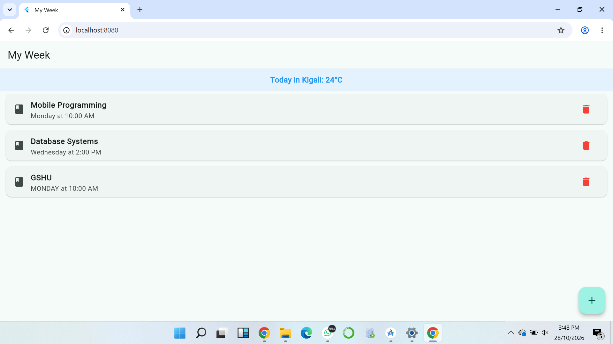
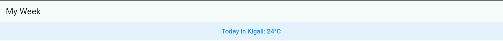
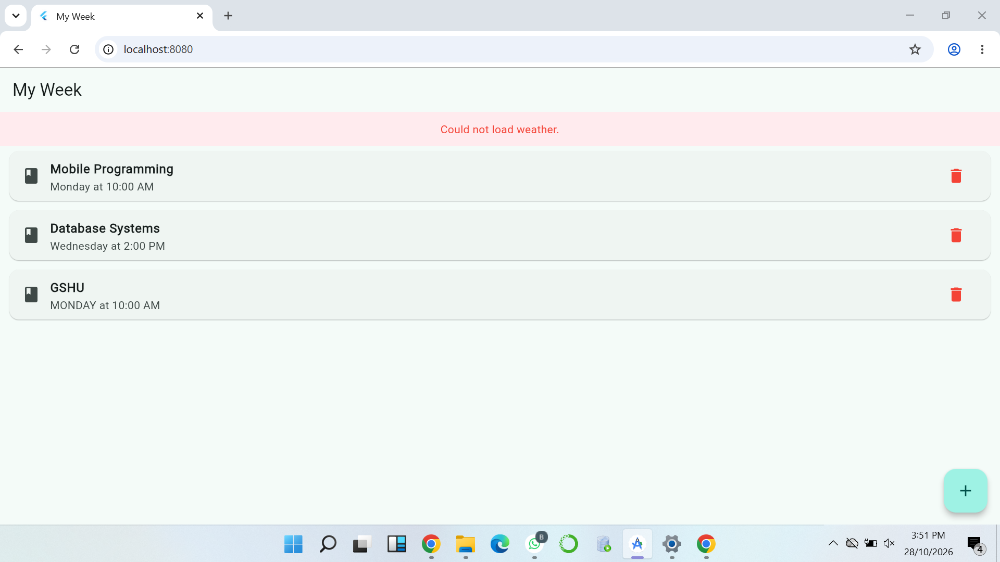

# My Week (SESSION 6)

A Flutter app to organize my weekly class schedule. It signs users in with Firebase Authentication, and each user's data is saved in Cloud Firestore under their own id, so two accounts never see each other's data, and every change appears live.

## Screenshots

# My Week (SESSION 5)

A Flutter app to organize my weekly class schedule. My data is now saved on the phone with shared_preferences, so nothing is lost when the app closes, and it shows the current live weather in Kigali from the Open-Meteo API.

## Screenshots

## Before closing

## After running again

## Live Data from the api

## No internet Access

