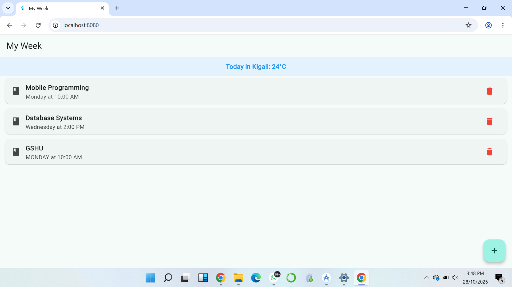
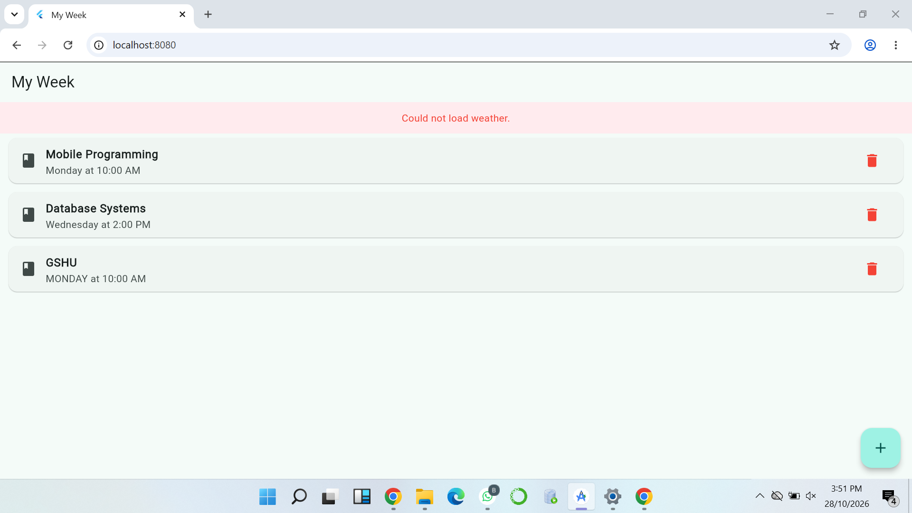

# My Week

A Flutter app to organize my weekly class schedule. My data is now saved on the phone with shared_preferences, so nothing is lost when the app closes, and it shows the current live weather in Kigali from the Open-Meteo API.

## Screenshots

